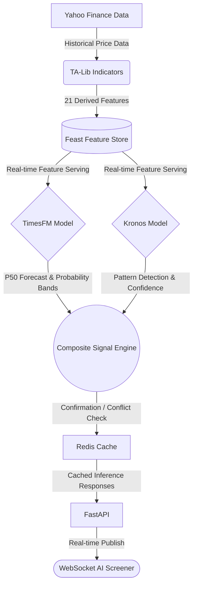

# Unified Finance Forecasting Engine


A unified financial forecasting, technical analysis, and AI screening platform powered by **Google's TimesFM**, **Kronos**, **TA-Lib**, and **Feast Feature Store**.

This engine identifies trading patterns, generates multi-horizon probability forecasts, backtests composite trading strategies, and serves a unified AI rating screener via a fast asynchronous FastAPI backend.

---

## Features

- Multi-horizon forecasting using TimesFM
- Candlestick pattern detection using Kronos
- Technical indicators using TA-Lib
- Feast Feature Store integration
- FastAPI inference APIs
- Redis caching
- Composite AI signal engine
- AI Screener
- WebSocket real-time updates
- Walk-forward backtesting
- Portfolio optimization

---

## Tech Stack

- Python
- FastAPI
- PyTorch
- TimesFM 2.5
- Kronos
- TA-Lib
- Feast
- Redis
- SQLite
- Yahoo Finance

---

## Architecture Overview



### Core Architecture Components

* **Feast Feature Store**: Feast provides an offline feature store for generating point-in-time correct training datasets, and an online feature store for extremely low-latency, real-time feature retrieval during inference.
* **Redis Caching**: Prediction responses are cached in Redis (with a TTL of 300 seconds) to heavily reduce repeated ML inference latency on identical requests.

### Current Model Configuration

**TimesFM Context Window**: The current implementation uses a maximum context window of 512 observations. Support for larger context windows can be enabled in future model configurations.

### Future Enhancements

- Live market streaming
- Docker deployment
- Kubernetes deployment
- GPU quantization support
- Multi-market screening
- LLM-generated market summaries

---

## 🛠 Prerequisites
- **Python 3.11+**
- **Git**
- **Redis** (Used for caching and WebSocket pub/sub)
- **TA-Lib** (C++ underlying library required)

---

## 🚀 Setup & Installation (Cross-Platform)

### 1. Virtual Environment
**macOS / Linux:**
```bash
python3 -m venv fin-env
source fin-env/bin/activate
```

**Windows (PowerShell):**
```powershell
python -m venv fin-env
.\fin-env\Scripts\Activate.ps1
```

**Windows (Command Prompt):**
```cmd
fin-env\Scripts\activate.bat
```

### 2. Install Python Dependencies
```bash
pip install -r requirements.txt
```

### 3. Install TA-Lib
TA-Lib requires the underlying C++ library to be installed before the Python wrapper can compile.

**macOS:**
```bash
brew install ta-lib
```

**Windows:**
The easiest way on Windows is to download the unofficial precompiled wheel for your Python version from [Christoph Gohlke's repository](https://www.lfd.uci.edu/~gohlke/pythonlibs/#ta-lib) or use `conda install -c conda-forge ta-lib`. 

### 4. Install & Start Redis
**macOS:**
```bash
brew install redis
brew services start redis
```

**Windows:**
Redis is not officially supported directly on Windows. The recommended approach is **Docker Desktop**:
```powershell
docker run -d -p 6379:6379 redis
```
*(Alternatively, use WSL2 or a native Windows port like Memurai).*

### 5. Clone External Machine Learning Dependency
We use an external repository for the Kronos forecasting model. It must be cloned directly into the `models/` directory.

```bash
git clone https://github.com/shiyu-coder/Kronos.git models/kronos_repo
```

---

## 🏗 Project Folder Structure

```text
finance-forecasting/
├── api/                   # FastAPI routes, schemas, and WebSocket
├── data/                  # Raw/processed data and benchmark summaries
├── feature_repo/          # Feast entity and feature view definitions
├── feature_store/         # SQLite offline backing store
├── features/              # TA-Lib indicators and Feast wrapping logic
├── models/                # TimesFM, Kronos adapters and Ensembles
│   └── kronos_repo/       # Cloned external Kronos dependency (Ignored in Git)
├── scripts/               # Benchmarking, PDF generation, data population
├── utils/                 # Caching, Risk Engine, Walk-Forward backtester
├── requirements.txt
├── README.md
└── .gitignore
```

---

## ⚡ Running the API

Once all dependencies (including Redis) are running, start the FastAPI server:

**macOS / Linux:**
```bash
uvicorn api.app:app --reload
```

**Windows:**
```powershell
uvicorn api.app:app --reload
```

---

## 📡 API Endpoints

| Endpoint | Description |
|----------|-------------|
| `/predict/{ticker}` | Unified forecast |
| `/predict/kronos/{ticker}` | Pattern detection |
| `/predict/timesfm/{ticker}` | Multi-horizon forecast |
| `/api/v1/screeners/ai-filter` | AI screener |
| `/ws/screener` | WebSocket updates |

### API Examples

> **Note for Windows Users:** The examples below use `curl`. If you are using PowerShell, you can replace the `curl -X GET` commands with `Invoke-RestMethod -Uri`. For example:
> `Invoke-RestMethod -Uri "http://localhost:8000/predict/kronos/AAPL?timeframe=1d"`


**Kronos Pattern Detection**
```bash
curl -X GET "http://localhost:8000/predict/kronos/AAPL?timeframe=1d"
```
*Expected Response:*
```json
{
  "ticker": "AAPL",
  "label": "Bullish",
  "confidence": 0.93,
  "forecast_step": 18
}
```

**TimesFM Forecast Endpoint**
Predict 30-day ahead trajectories for Apple:
```bash
curl -X GET "http://localhost:8000/predict/timesfm/AAPL?horizons=30"
```

**AI Screener (Composite Filter)**
Filter a fixed universe for a specific pattern matching a minimum confidence threshold.
```bash
curl -X GET "http://localhost:8000/api/v1/screeners/ai-filter?pattern=bullish_engulfing&min_confidence=0.70"
```

---

## 🔧 Troubleshooting

- **Redis Connection Errors:** Ensure the Redis server is actually running on port `6379`. On Windows, ensure Docker Desktop is running and the container is active.
- **TA-Lib Installation Issues:** If `pip install -r requirements.txt` fails building TA-Lib, you must install the underlying C library first (using `brew` on Mac, or a `.whl` / `conda` on Windows).
- **Feast Initialization Problems:** Make sure to run `feast apply` inside the `feature_repo` directory if modifying feature views. The `populate_feature_store.py` script automates initial materialization.
- **Apple Silicon (MPS) vs CUDA vs CPU Execution:** The models in `models/device.py` will attempt to auto-detect MPS on Mac or CUDA on Windows/Linux. Ensure your PyTorch installation matches your hardware.
- **Missing Kronos Repository:** If the API fails on boot stating `ModuleNotFoundError` for Kronos, ensure you cloned the repo exactly to `models/kronos_repo`.
- **Python Virtual Environment Activation Problems:** Ensure you are using the correct command for your OS and shell profile (e.g. `Set-ExecutionPolicy Unrestricted -Scope CurrentUser` may be required in PowerShell).
